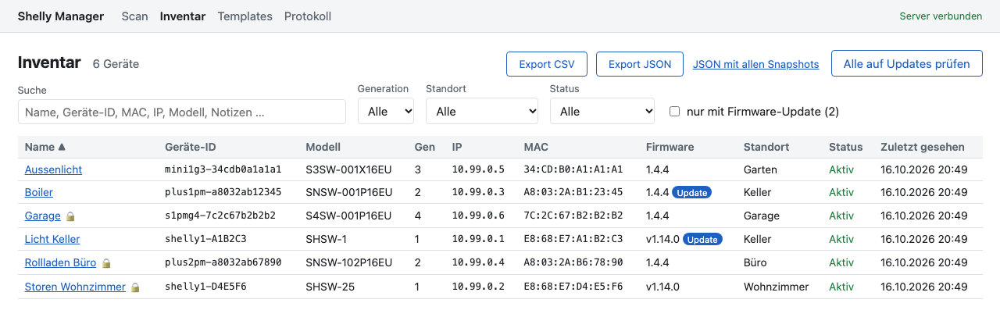

# Shelly Manager

[](https://github.com/yfridelance/shelly-manager/actions/workflows/ci.yml)
[](LICENSE)

Self-hosted web app to discover, document and manage [Shelly](https://www.shelly.com) devices (Gen1 to Gen4) on
your local network: no cloud, no account, one Docker container.

It started with a concrete job: a house was being sold, and dozens of Shellys had to be inventoried, documented and
then reset to factory settings, one by one and safely. It grew into a tool for anyone who runs more than a
handful of Shellys: homelabs, installers, property managers.



## Features

- **Network scan** of an IP range (CIDR or start/end) that detects generation, model, device ID, MAC, firmware and
  name. Gen1 (REST, Basic auth) and Gen2+ (JSON-RPC, Digest auth) are both supported.
- **Inventory** with search, filters, sorting, and per-device location, type and notes. It detects each device's
  **function** automatically (switch, cover, light, energy meter, power metering). Export as CSV and JSON.
- **Sites**: several houses or customers in one installation, each with its own inventory, templates and log.
- **Config snapshots** with history and a diff view between two snapshots.
- **Reboot, firmware updates and factory reset per device**, with safety checks:
  - confirm by typing the MAC or name
  - automatic snapshot before the reset
  - MAC check before every action
  - deliberately no bulk reset
- **Templates**: apply curated settings to many devices at once after a preview, translated for Gen1 and Gen2+.
  Covers MQTT, cloud, time and location, Bluetooth, Wi-Fi AP, roaming, CoIoT, scripts, and DHCP or static IPs.
  Static IPs are assigned in sequence, with conflict checks and a CSV export for DHCP reservations.
- **Action log**: who did what, when, and with which result.
- **Device passwords are never stored**: they are kept in memory for a single request only.

## Quick start

```bash
git clone https://github.com/yfridelance/shelly-manager.git
cd shelly-manager
docker compose up -d --build
```

Or use the prebuilt image (amd64 and arm64) without cloning, see [Operations](docs/betrieb.md#fertiges-image-ghcr):
`ghcr.io/yfridelance/shelly-manager:latest`.

Open **http://localhost:8080**, go to «Scan» and enter your network range, e.g. `192.168.1.0/24`.

> The user interface and the detailed documentation are currently in **German**. The UI is ready for translation
> (one JSON file per language, switchable at runtime); translations are very welcome, see
> [How to translate](CONTRIBUTING.md#how-to-translate).

## Documentation

| Document | Content |
|---|---|
| [User manual](docs/benutzerhandbuch.md) (German) | Scan, inventory, device details, factory reset, firmware, templates, sites, log, export, troubleshooting |
| [Operations](docs/betrieb.md) (German) | Docker, networking, reverse proxy and `ALLOWED_HOSTS`, environment variables, backup, updates |
| [Development](docs/entwicklung.md) (German) | Setup, architecture, database, tests and mock fleet, CI, extending |
| [CLAUDE.md](CLAUDE.md) (German) | Binding rules and reference: Shelly API notes, data model, REST API, safety rules |

## Development

Requires Node.js 24 (at least 24.15, e.g. via `nvm use`).

```bash
npm install
npm run dev        # server :3000 + Angular :4200
npm run dev:mock   # plus a mock Shelly fleet; scan 10.99.0.0/24 in the UI
npm run build
npm test
```

You do not need real devices: the mock fleet emulates Gen1 to Gen4 devices with and without passwords. Stack:
TypeScript, Fastify, SQLite (better-sqlite3), Angular, Vitest.

## Security

The app has **no login** and can factory-reset devices. That is why the Docker port is bound to `127.0.0.1` only
and the API accepts only allowed host names (protection against DNS rebinding). To reach it from other machines,
put a reverse proxy with authentication in front of it; see
[Operations](docs/betrieb.md#zugriff-von-anderen-rechnern). To report a vulnerability, see [SECURITY.md](SECURITY.md).

## Status and roadmap

All core features work and are covered by tests against the mock fleet. Real-world testing is ongoing, so reports
from real devices are especially valuable. Ideas for what comes next:

- drift detection: compare devices against a template as their target state
- mDNS discovery, Shelly BLU devices
- an English (and other) UI translation
- distributed collectors per site

## Contributing

Questions, ideas or want to show your setup? Join the
[Discussions](https://github.com/yfridelance/shelly-manager/discussions).

Bug reports, test results from real devices, translations and pull requests are welcome. Please read
[CONTRIBUTING.md](CONTRIBUTING.md) first.

## License

[MIT](LICENSE) © Yves Fridelance

Shelly is a trademark of Shelly Group. This project is independent and not affiliated with or endorsed by
Shelly Group.
