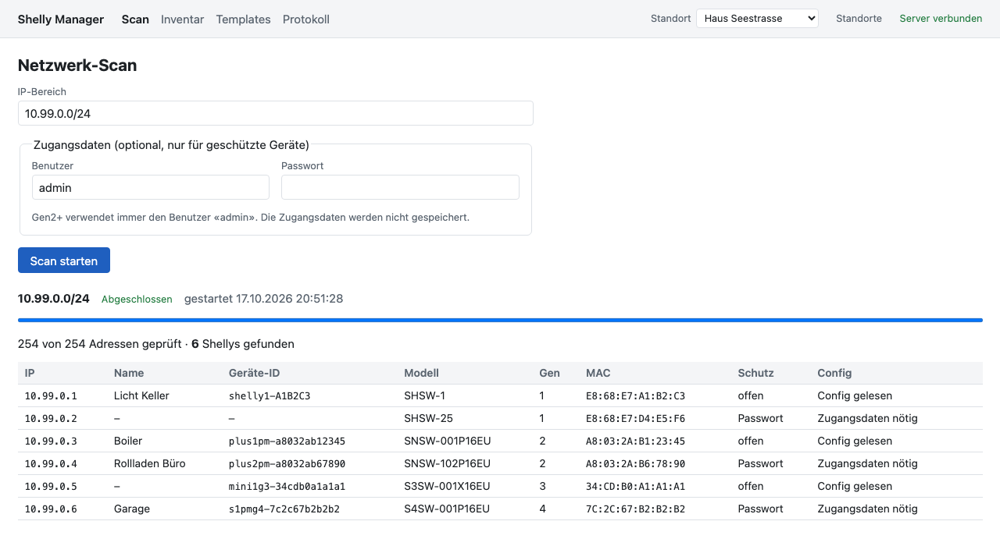
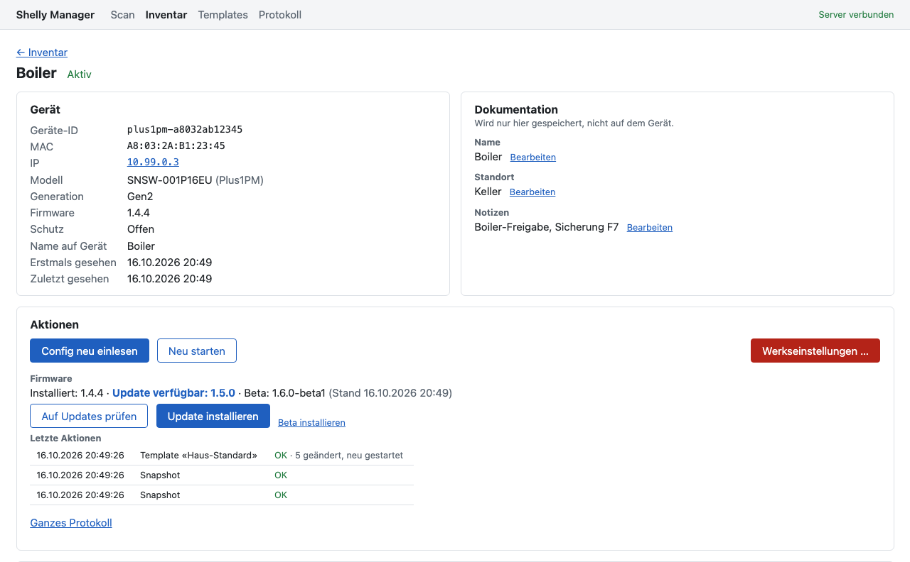
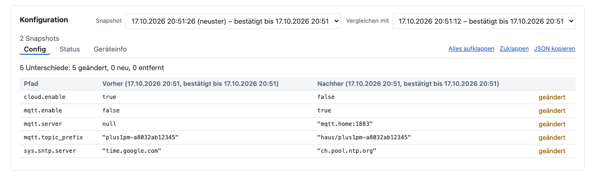
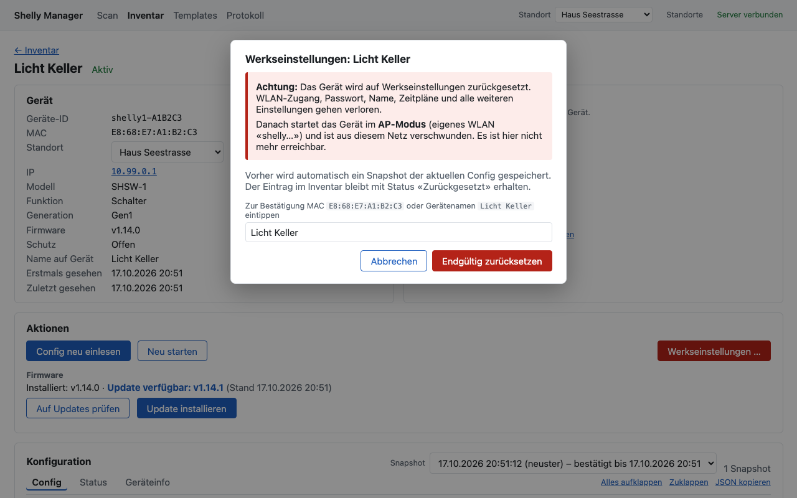
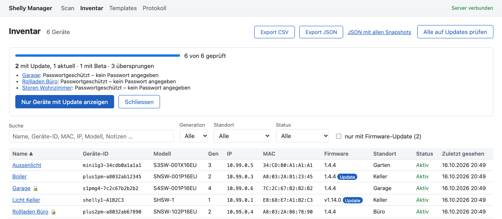
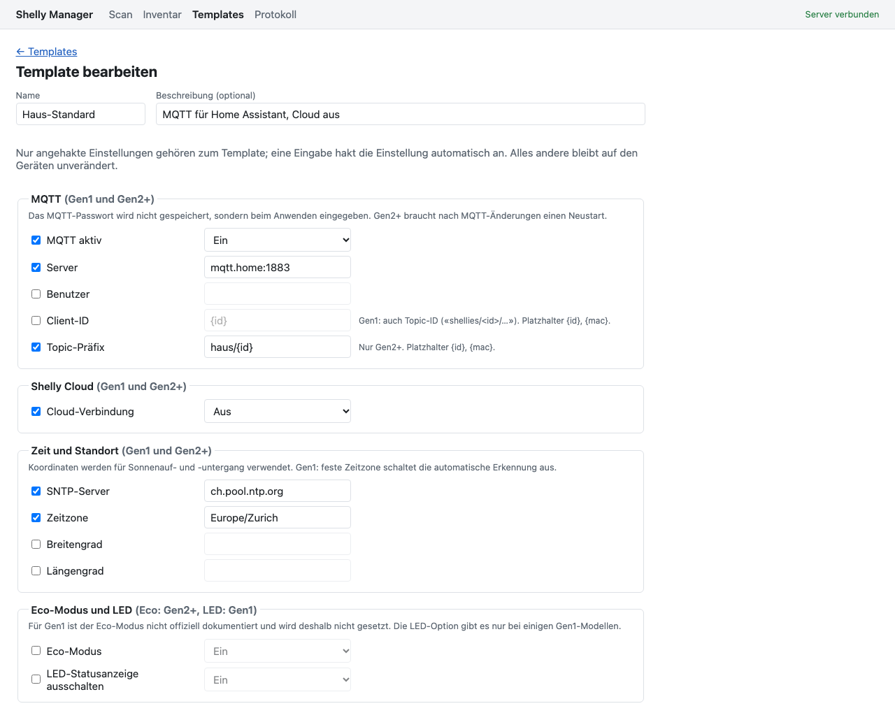
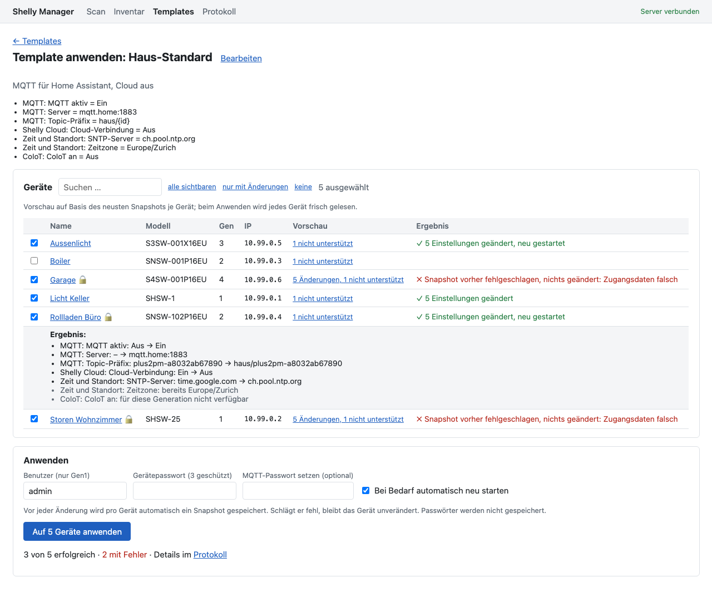
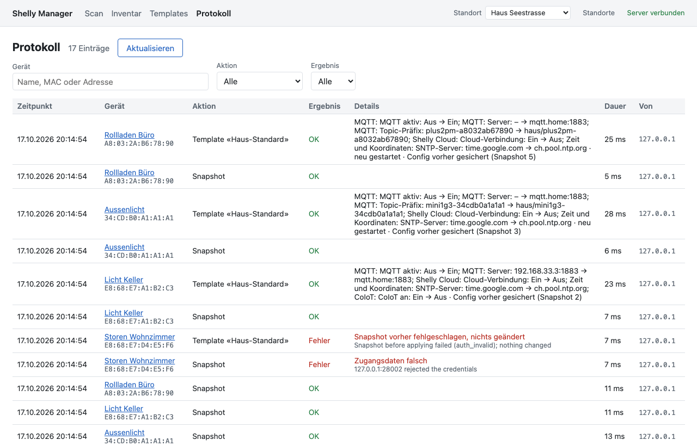

# Benutzerhandbuch

Shelly Manager findet Shelly-Geräte (Gen1 bis Gen4) im lokalen Netz, dokumentiert sie und hilft beim Verwalten:
Konfiguration sichern, Neustart, Firmware-Updates, Einstellungen per Template auf mehrere Geräte verteilen und
Geräte einzeln auf Werkseinstellungen zurücksetzen.

Die App läuft im Browser. Installation und Betrieb sind in [betrieb.md](betrieb.md) beschrieben. Die Screenshots
zeigen Beispieldaten aus der Mock-Fleet, mit der die App ohne echte Geräte getestet wird.

**Inhalt**

1. [Überblick](#1-überblick)
2. [Netzwerk scannen](#2-netzwerk-scannen)
3. [Inventar](#3-inventar)
4. [Gerätedetail](#4-gerätedetail)
5. [Werkseinstellungen](#5-werkseinstellungen)
6. [Firmware-Updates](#6-firmware-updates)
7. [Templates](#7-templates)
8. [Protokoll](#8-protokoll)
9. [Export](#9-export)
10. [Passwörter und Sicherheit](#10-passwörter-und-sicherheit)
11. [Ablauf beim Hausverkauf](#11-ablauf-beim-hausverkauf)
12. [Meldungen und Fehlerbehebung](#12-meldungen-und-fehlerbehebung)
13. [Standorte](#13-standorte)

---

## 1. Überblick

Die Navigation oben hat vier Bereiche:

| Bereich | Zweck |
|---|---|
| **Scan** | IP-Bereich nach Shelly-Geräten absuchen |
| **Inventar** | Alle bekannten Geräte, Suche, Filter, Export, Firmware-Prüfung |
| **Templates** | Einstellungen zusammenstellen und auf mehrere Geräte anwenden |
| **Protokoll** | Alle ausgeführten Aktionen mit Ergebnis |
| **Standort** (oben rechts) | Auswahl des Standorts, in dem du arbeitest; «Standorte» verwaltet sie |

Oben rechts zeigt «Server verbunden», dass die App ihren Server erreicht.

Ein paar Grundsätze, die überall gelten:

- **Ein Gerät ist durch seine MAC-Adresse bestimmt**, nicht durch die IP. Wechselt ein Gerät die IP, bleibt es dasselbe
  Gerät im Inventar, mit Ort und Notizen.
- **Bevor die App etwas an einem Gerät tut**, prüft sie, ob unter der gespeicherten IP noch dasselbe Gerät antwortet.
  Antwortet dort ein anderes, bricht sie ab («Unter dieser IP antwortet ein anderes Gerät. Bitte neu scannen.»).
- **Pro Gerät läuft immer nur eine Aktion gleichzeitig.**
- **Snapshots:** Die App speichert die Antworten der Geräte (Geräteinfo, Config, Status) unverändert. Vor jedem
  Werksreset und vor jedem Template wird automatisch ein Snapshot gemacht.
- **Gerätepasswörter werden nie gespeichert.** Sie werden nur für die jeweilige Aktion verwendet.

## 2. Netzwerk scannen

Unter **Scan** gibst du einen IP-Bereich ein:

| Eingabe | Bedeutung |
|---|---|
| `192.168.1.0/24` | ganzes Netz (ohne Netz- und Broadcast-Adresse) |
| `192.168.1.10-192.168.1.80` | Bereich von–bis |
| `192.168.1.33` | eine einzelne Adresse |

Höchstens **1024 Adressen** pro Scan. Die App fragt 32 Adressen gleichzeitig an und wartet pro Adresse höchstens
1,5 Sekunden. Ein `/24`-Netz dauert so meist nur wenige Sekunden. Es läuft immer nur ein Scan; mit **Abbrechen**
lässt er sich jederzeit stoppen.

**Zugangsdaten (optional):** Sind Geräte passwortgeschützt, kannst du Benutzer und Passwort angeben. Gen2+ verwendet
immer den Benutzer `admin`; der Benutzer im Feld gilt nur für Gen1. Pro Scan gibt es genau ein Paar Zugangsdaten.
Geräte mit einem anderen Passwort werden trotzdem erfasst, aber ohne Config. Das Passwortfeld wird beim Start geleert.

**Ergebnis:** Die Trefferliste zeigt IP, Name, Geräte-ID, Modell, Generation, MAC, Schutz und ob die Config gelesen
werden konnte. Neu entdeckte Geräte sind mit «neu» markiert.

- «Config gelesen»: Das Gerät ist vollständig erfasst, inklusive Snapshot.
- «Zugangsdaten nötig»: geschütztes Gerät ohne Passwort im Scan. Es ist im Inventar, aber ohne Config.
- Fehlertexte (z.B. «Zugangsdaten falsch») betreffen nur dieses eine Gerät; der Scan läuft weiter.

**Was ein Scan im Inventar aktualisiert:** IP, Firmware, Generation, Modell, «zuletzt gesehen» und verfügbare
Firmware-Updates. **Ort und Notizen bleiben immer unverändert.** Bekannte Geräte, die im gescannten Bereich
nicht mehr antworten, werden als **Vermisst** markiert (nur bei abgeschlossenen, nicht bei abgebrochenen Scans).
Taucht ein vermisstes Gerät wieder auf, ist es wieder **Aktiv**.

Hat sich an der Config eines Geräts nichts geändert, legt ein Scan keinen neuen Snapshot an, sondern bestätigt den
letzten (siehe [Gerätedetail](#konfiguration-und-snapshots)).

> **Gen1 und Namen/IDs:** Gen1-Geräte melden Name und Geräte-ID nur über ihre Einstellungen. Bei geschützten
> Gen1-Geräten erscheinen sie deshalb erst, wenn einmal mit Passwort gescannt oder die Config eingelesen wurde.

## 3. Inventar

Die Tabelle zeigt alle Geräte des gewählten [Standorts](#13-standorte): Name, Geräte-ID, Modell, Generation, IP, MAC, Firmware, Ort, Status
und «zuletzt gesehen». Ein Klick auf eine Zeile öffnet die [Detailansicht](#4-gerätedetail). Ein 🔒 hinter dem
Namen bedeutet: passwortgeschützt.

- **Suche:** durchsucht Name, Geräte-ID, MAC (mit oder ohne Doppelpunkte), IP, Modell, Ort, Notizen und Firmware.
- **Filter:** Generation, Ort (auch «ohne Ort»), Status (Aktiv, Vermisst, Zurückgesetzt) und
  «nur mit Firmware-Update».
- **Sortieren:** Klick auf eine Spaltenüberschrift, nochmals klicken kehrt die Reihenfolge um.
  Filter und Sortierung bleiben erhalten, wenn du ins Detail und zurück wechselst.
- **Geräte-ID:** Gen2+ zum Beispiel `shellyplus1pm-a8032ab12345`, Gen1 der Hostname wie `shelly1-A1B2C3`.
  Unter dieser ID erscheint das Gerät in der Shelly-App, in MQTT-Topics und im Netzwerk.
- **Firmware:** gekürzt (z.B. `1.4.4`); die volle Bezeichnung steht im Tooltip. Ein Badge «Update» zeigt eine
  neuere Firmware an.
- **Export CSV / Export JSON:** siehe [Export](#9-export).
- **Alle auf Updates prüfen:** siehe [Firmware-Updates](#6-firmware-updates).

Status:

| Status | Bedeutung |
|---|---|
| Aktiv | beim letzten Scan gefunden |
| Vermisst | im gescannten Bereich nicht mehr gefunden |
| Zurückgesetzt | per App auf Werkseinstellungen zurückgesetzt; der Eintrag bleibt als Dokumentation erhalten |

## 4. Gerätedetail

### Gerät

Geräte-ID, MAC, IP (als Link zur Weboberfläche des Geräts), Modell, Generation, Firmware, Schutz, der Name auf dem
Gerät sowie «erstmals» und «zuletzt gesehen».

### Dokumentation

**Name, Ort und Notizen** werden nur in der App gespeichert, **nicht auf dem Gerät**. Klick auf «Bearbeiten»,
ändern, mit Enter (bei Notizen Ctrl/⌘+Enter) oder «Speichern» übernehmen; Escape bricht ab. Beim Ort (Raum, z.B.
«Keller») schlägt die App bereits verwendete Orte des Standorts vor.

Unter **Gerät → Standort** lässt sich das Gerät nach einer Rückfrage in einen anderen [Standort](#13-standorte)
verschieben.

Den lokalen Namen leeren zeigt wieder den Namen, den das Gerät selbst meldet. Solange du den Namen nicht lokal
änderst, übernimmt die App Umbenennungen auf dem Gerät automatisch.

### Aktionen

- **Config neu einlesen:** liest Geräteinfo, Config und Status und speichert sie als Snapshot.
- **Neu starten:** mit Rückfrage.
- **Firmware:** installierte Version, verfügbare Updates, «Auf Updates prüfen» und «Update installieren»
  (siehe [Firmware-Updates](#6-firmware-updates)).
- **Werkseinstellungen …:** öffnet den Reset-Dialog (siehe [Werkseinstellungen](#5-werkseinstellungen)).

Bei passwortgeschützten Geräten erscheint ein Feld **Gerätepasswort** (bei Gen1 zusätzlich Benutzer). Das Passwort
gilt nur für die nächste Aktion und wird danach geleert. Für zurückgesetzte Geräte werden keine Aktionen mehr
angeboten; sie erscheinen nach dem nächsten Scan wieder als aktiv, falls sie neu eingerichtet wurden.

**Letzte Aktionen** listet die letzten zehn Aktionen dieses Geräts mit kurzem Ergebnis, z.B.
«Template «Haus-Standard» · OK · 2 geändert, neu gestartet». Der volle Text erscheint beim Darüberfahren.

### Konfiguration und Snapshots

Die Config, der Status und die Geräteinfo werden als einklappbarer Baum angezeigt (Reiter **Config**, **Status**,
**Geräteinfo**). «Alles aufklappen», «Zuklappen» und «JSON kopieren» helfen beim Lesen und Dokumentieren.

- **Snapshot:** Auswahl älterer Snapshots. Ein neuer Snapshot entsteht nur, wenn sich Config oder Geräteinfo geändert
  haben. Sonst wird der letzte Snapshot **bestätigt**: «Config gelesen am …, unverändert bestätigt bis …». Der Status
  stammt dann vom Zeitpunkt der letzten Bestätigung.
- **Vergleichen mit:** zeigt die Unterschiede zu einem zweiten Snapshot als Tabelle Vorher/Nachher (der ältere links),
  mit Pfaden wie `sys.device.name` oder `relays[0].ison`, markiert als geändert, neu oder entfernt. Im Reiter Status
  ändern sich auch Laufzeitwerte wie Uptime oder Leistung.

## 5. Werkseinstellungen

Der Werksreset ist absichtlich nur **pro Gerät** möglich. Ablauf:

1. In der Detailansicht **Werkseinstellungen …** wählen.
2. Der Dialog erklärt die Folgen: Alle Einstellungen (WLAN-Zugang, Passwort, Name, Zeitpläne …) gehen verloren, das
   Gerät startet im **AP-Modus** (eigenes WLAN «shelly…») und ist **aus diesem Netz verschwunden**.
3. Zur Bestätigung die **MAC** (Schreibweise egal) oder den **Gerätenamen** eintippen. Erst dann wird
   «Endgültig zurücksetzen» aktiv.
4. Bei geschützten Geräten das Gerätepasswort angeben.

Was die App dabei tut:

- Vor dem Reset speichert sie **automatisch einen Snapshot**. Schlägt dieser fehl, wird der Reset **nicht**
  ausgeführt. Erst dann bietet der Dialog die Option «Trotzdem ohne Snapshot zurücksetzen» an; diese Wahl wird im
  Protokoll festgehalten.
- Sie prüft nochmals, dass unter der IP wirklich dieses Gerät antwortet.
- Nach dem Reset bleibt der Eintrag im Inventar mit Status **Zurückgesetzt**, inklusive Ort, Notizen und
  gesichertem Snapshot.

**«Reset vermutlich erfolgreich – Gerät nicht mehr erreichbar»:** Manche Geräte trennen die Verbindung, bevor sie den
Reset bestätigen. Die App prüft dann nach ein paar Sekunden erneut. Ist das Gerät weg (oder ist sein Passwortschutz
verschwunden), gilt der Reset als vermutlich erfolgreich. Ein neuer Scan zeigt den tatsächlichen Stand.

## 6. Firmware-Updates

- **Bei jedem Scan und Snapshot** liest die App aus dem Gerätestatus mit, ob neuere Firmware verfügbar ist. Im
  Inventar erscheint dann das Badge «Update»; der Filter «nur mit Firmware-Update» zeigt nur diese Geräte.
- **Auf Updates prüfen** (Detailansicht) fragt das Gerät aktiv. Das Gerät erkundigt sich dazu beim Update-Server
  von Shelly und braucht deshalb Internetzugang.
- **Alle auf Updates prüfen** (Inventar) prüft alle aktiven Geräte mit IP, sechs gleichzeitig, mit Fortschritt und
  Abbruch. Ein optionales Passwort gilt nur für geschützte Geräte; ohne Passwort werden diese übersprungen. Am Ende
  zeigt eine Zusammenfassung, wie viele Geräte ein Update haben; «Nur Geräte mit Update anzeigen» filtert direkt.
  Dabei wird nichts installiert.

- **Update installieren** (Detailansicht) startet nach einer Rückfrage das Update auf dem stabilen Kanal; Beta-Versionen
  lassen sich separat installieren, wenn das Gerät eine anbietet. Das Gerät lädt die Firmware, installiert sie und
  startet selbst neu. Die neue Version erscheint nach dem nächsten Scan oder «Config neu einlesen».

Die Prüfung wird nicht protokolliert, die Installation schon («1.4.4 → 1.5.0 (Stabil)»).

## 7. Templates

Ein Template fasst Einstellungen zusammen, die auf mehrere Geräte angewendet werden. Die App übersetzt sie für jede
Generation in die passenden Befehle.

### Template anlegen

Unter **Templates → Neues Template** Name und optional Beschreibung eingeben. Dann die gewünschten Einstellungen
**anhaken**. Eine Eingabe in einem Feld hakt die Einstellung automatisch an. **Nur angehakte Einstellungen gehören
zum Template**; alles andere bleibt auf den Geräten unverändert.

| Gruppe | Einstellungen | Gen1 | Gen2+ |
|---|---|---|---|
| MQTT | aktiv, Server, Benutzer, Client-ID | ✓ | ✓ (Neustart nötig) |
|  | Topic-Präfix | – | ✓ |
| Shelly Cloud | Verbindung an/aus | ✓ | ✓ |
| Zeit und Koordinaten | SNTP-Server, Zeitzone, Breiten-/Längengrad | ✓ | ✓ |
| Eco-Modus und LED | Eco-Modus | – | ✓ |
|  | LED-Statusanzeige aus | nur manche Modelle | – |
| Bluetooth | Bluetooth an, BLE-RPC, Observer | – | ✓ (an/aus und Observer nur ältere Firmware) |
| WLAN-Access-Point | AP an/aus | – | ✓ (Einschalten nur mit AP-Passwort) |
| AP-Roaming | an/aus, Schwelle (dBm) | ✓ | ✓ |
| CoIoT | an/aus, Intervall, Peer | ✓ | – |
| Script | Name, Code, beim Start ausführen, nach dem Verteilen starten | – | ✓ |
| Netzwerk (WLAN) | Haupt- und zweites WLAN: DHCP oder statisch (IP ab, Netzmaske, Gateway, DNS) | ✓ | ✓ |

- **Platzhalter:** In Client-ID und Topic-Präfix werden `{id}` (Geräte-ID) und `{mac}` pro Gerät ersetzt,
  z.B. `haus/{id}`.
- **Nicht in Templates:** SSID und WLAN-Passwort sowie das Gerätepasswort. Ein Fehler würde Geräte aus dem Netz
  werfen, und Passwörter speichert die App grundsätzlich nicht. Die IP-Einstellungen des WLANs gehören dazu, siehe
  [Netzwerk](#netzwerk-dhcp-oder-statische-ip).
- **Gen1 und Eco-Modus:** Für Gen1 ist der Eco-Modus nicht offiziell dokumentiert und wird deshalb nicht gesetzt.
- **WLAN-Access-Point bei Gen1:** nicht möglich, weil sich dort AP und WLAN-Verbindung ausschliessen.
- **Scripts** werden per Name angelegt oder aktualisiert. Ist der Code auf dem Gerät gleich, bleibt das Script
  unberührt.

«Speichern und Vorschau» speichert das Template und öffnet die Seite zum Anwenden.

### Template anwenden

1. **Geräte wählen:** einzeln, «alle sichtbaren», «nur mit Änderungen» oder «keine». Die Suche schränkt die Liste ein.
   Angeboten werden nur aktive Geräte mit IP.
2. **Vorschau prüfen:** Pro Gerät steht, was sich ändern würde, z.B. «2 Änderungen, 1 nicht unterstützt». Ein Klick
   öffnet die Liste: «MQTT: Server: 192.168.33.3:1883 → mqtt.home:1883», «bereits …» für Werte, die schon stimmen,
   und «nicht verfügbar» oder «nicht unterstützt», wenn Generation, Modell oder Firmware die Einstellung nicht kennen.
   Die Vorschau beruht auf dem neusten Snapshot; ohne Snapshot steht «kein Snapshot, wird beim Anwenden ermittelt».
   Für die Vorschau wird kein Gerät kontaktiert.
3. **Passwörter:** Gerätepasswort für geschützte Geräte. Optional ein **MQTT-Passwort** (wird gesetzt, wenn
   angegeben) und ein **AP-Passwort** (mindestens 8 Zeichen). Keines davon wird gespeichert.
4. **Bei Bedarf automatisch neu starten:** Manche Änderungen (z.B. MQTT bei Gen2+) werden erst nach einem Neustart
   aktiv. Ist die Option aus, steht im Ergebnis «Neustart nötig».
5. **«Auf N Geräte anwenden»** und die Rückfrage bestätigen.

Pro Gerät passiert dann:

- **Snapshot vorher.** Schlägt er fehl, bleibt das Gerät unverändert.
- Prüfung, dass unter der IP noch dasselbe Gerät antwortet.
- Es werden **nur die Werte gesendet, die abweichen**. Ein zweiter Durchlauf ändert nichts mehr («keine Änderung nötig»).
- **Snapshot nachher** mit dem neuen Stand (vor einem allfälligen Neustart).
- Neustart, falls nötig und gewünscht.

Es laufen vier Geräte gleichzeitig. Die Spalte **Ergebnis** zeigt pro Gerät «✓ 3 Einstellungen geändert, neu
gestartet», «✓ keine Änderung nötig» oder «✗» mit Grund. Ein Fehler betrifft nur dieses Gerät.

> **Access-Point einschalten:** Seit Firmware 2.0 verlangen Shellys dafür ein Passwort. Ohne AP-Passwort wird der AP
> nicht eingeschaltet («AP-Passwort nötig, wird nicht eingeschaltet»); die übrigen Einstellungen werden trotzdem
> angewendet.

### Netzwerk: DHCP oder statische IP

In der Gruppe **Netzwerk (WLAN)** lässt sich für das Haupt-WLAN und das zweite WLAN (falls auf dem Gerät eingerichtet)
festlegen, ob das Gerät seine Adresse per **DHCP** bekommt oder eine **statische IP**. Für statisch gibst du «IP ab»,
Netzmaske und optional Gateway und DNS an. SSID und WLAN-Passwort bleiben immer unverändert.

- **Fortlaufende Vergabe:** Beim Anwenden verteilt die App die Adressen ab «IP ab» aufsteigend auf die ausgewählten
  Geräte, sortiert nach Ort und Name. Belegte Adressen (andere Geräte im Inventar, Gateway, Netz- und
  Broadcast-Adresse) werden übersprungen. Geräte, die schon eine statische IP im Bereich haben, behalten sie; ein
  zweiter Durchlauf ändert also nichts.
- **IP anpassen:** Die Spalte **Neue IP** zeigt die geplante Adresse pro Gerät und lässt sich ändern. Ändert sich die
  Auswahl, plant die App neu.
- **Prüfungen vor dem Ändern:** Die Adresse muss im Netz liegen, darf keinem anderen Gerät im Inventar gehören und unter
  ihr darf nichts antworten. Sonst bleibt das Gerät unverändert («Die geplante IP ist nicht verfügbar»).
  Geräte ohne Webserver (Handys, Drucker …) erkennt diese Prüfung nicht. Den Bereich deshalb **ausserhalb des
  DHCP-Pools** des Routers wählen.
- **Ablauf:** Die Netzwerkänderung kommt als letzter Schritt. Danach sucht die App das Gerät unter der neuen IP, prüft
  die MAC und trägt die neue IP im Inventar ein. Erst dann folgen Snapshot und ein allfälliger Neustart.
  Ist das Gerät dort nicht erreichbar, steht im Ergebnis «unter … nicht erreichbar – bitte neu scannen».
  Beim Wechsel auf DHCP ist die neue Adresse vorher unbekannt; antwortet das Gerät nicht mehr unter der alten,
  hilft ein neuer Scan.
- **Gen1 ohne Gateway:** Laut Shelly-Doku muss dafür vorher die Cloud aus sein. Die App setzt die statische IP sonst
  nicht («ohne Gateway muss bei Gen1 zuerst die Cloud aus sein»).
- **Export für DHCP-Reservierung:** Statt fester IPs auf den Geräten kannst du die geplanten Adressen auch im Router
  als DHCP-Reservierung hinterlegen. Der Knopf erzeugt dafür eine CSV mit Name, Geräte-ID, MAC und IP der
  ausgewählten Geräte. Das ist robuster, weil ein Tippfehler im Router kein Gerät aussperrt.

> **Wichtig:** Falsche Netzwerkwerte (z.B. eine falsche Netzmaske) machen Geräte unerreichbar; dann hilft nur der
> Werksreset am Gerät. Ein Netzwerk-Template **immer zuerst an einem Gerät** testen.

> **Tipp:** Ein neues Template zuerst auf **ein** Gerät anwenden, das Ergebnis in der Detailansicht mit
> «Vergleichen mit» prüfen und erst dann auf alle.

## 8. Protokoll

Das Protokoll listet alle Aktionen: Snapshot, Neustart, Werksreset, Firmware-Update und Template. Zu jedem Eintrag
gehören Zeitpunkt, Gerät, Ergebnis, Details, Dauer und **Von** (die Adresse des Rechners, von dem die Aktion kam; es
gibt keine Benutzerkonten). Filter nach Gerät, Aktion und Ergebnis; «Aktualisieren» lädt neu.

Die Details nennen zum Beispiel den gesicherten Snapshot vor einem Reset, ein bewusst übersprungenes Snapshot,
die Firmware-Versionen («1.4.4 → 1.5.0 (Stabil)») oder bei Templates jede geänderte Einstellung mit vorher und
nachher. Passwörter erscheinen nie im Klartext; dass ein Template ein Passwort gesetzt hat, steht nur als
`********`.

## 9. Export

Im Inventar oben rechts:

- **Export CSV:** Übersicht für Excel mit allen Spalten des Inventars plus Name auf Gerät, Notizen,
  passwortgeschützt, erstmals/zuletzt gesehen, letzter Snapshot, Zeitpunkt des Werksresets und verfügbares
  Firmware-Update. Format: Semikolon, UTF-8 mit BOM (Umlaute bleiben in Excel korrekt), Zeiten in UTC.
- **Export JSON:** alle Geräte mit der neusten Config, dem Status und der Geräteinfo, unverändert wie vom Gerät.
- **JSON mit allen Snapshots:** zusätzlich die ganze Snapshot-Historie.

Gerätepasswörter sind nie im Export, weil die App sie nicht speichert.

## 10. Passwörter und Sicherheit

- **Gerätepasswörter, MQTT- und AP-Passwörter** werden nur für die jeweilige Aktion verwendet, nie gespeichert und nie
  protokolliert. Die Eingabefelder werden nach dem Absenden geleert.
- Gen1-Geräte verwenden HTTP Basic Auth über unverschlüsseltes HTTP; Gen2+ verwenden Digest-Authentifizierung.
  Gen1 überträgt ein MQTT-Passwort technisch bedingt im Klartext an das Gerät.
- **Kein Login:** Die App ist für den Betrieb auf dem eigenen Rechner oder hinter einem Reverse Proxy mit Anmeldung
  gedacht. Sie nimmt nur Anfragen an Hostnamen an, die ausdrücklich erlaubt sind (Schutz gegen DNS-Rebinding,
  siehe [betrieb.md](betrieb.md#zugriff-von-anderen-rechnern)).
- **Kein Sammel-Reset:** Werkseinstellungen gibt es nur pro Gerät und nur nach Eintippen von MAC oder Namen.

## 11. Ablauf beim Hausverkauf

1. **Scannen**, wenn nötig mit Gerätepasswort, bis alle Geräte mit «Config gelesen» im Inventar sind.
2. **Dokumentieren:** Ort und Notizen pro Gerät erfassen (wo es verbaut ist, was es schaltet, Sicherung …).
3. **Exportieren:** CSV und JSON herunterladen und **ausserhalb des Laptops** ablegen.
4. **Zurücksetzen:** Gerät für Gerät über **Werkseinstellungen …**. Die App sichert vorher jeweils automatisch die
   Config.
5. **Abschluss-Export:** nochmals CSV und JSON exportieren; sie enthalten nun den Zeitpunkt jedes Werksresets.

## 12. Meldungen und Fehlerbehebung

| Meldung | Bedeutung / Abhilfe |
|---|---|
| Zugangsdaten erforderlich | Das Gerät ist geschützt; Passwort angeben. |
| Zugangsdaten falsch | Passwort (bei Gen1 auch Benutzer) prüfen. Shellys sperren nach vielen Fehlversuchen kurzzeitig. |
| Zeitüberschreitung | Das Gerät antwortet nicht rechtzeitig (WLAN schwach, Gerät beschäftigt). Später erneut versuchen. |
| Nicht erreichbar | Keine Verbindung zur IP. Gerät aus, IP gewechselt oder anderes Netz: neu scannen. |
| Unter dieser IP antwortet ein anderes Gerät. Bitte neu scannen. | Die IP gehört inzwischen einem anderen Gerät; aus Sicherheitsgründen bricht die App ab. |
| Keine IP-Adresse bekannt | Das Gerät wurde noch nie mit IP gesehen oder seine IP ging an ein anderes Gerät. Neu scannen. |
| Auf diesem Gerät läuft bereits eine Aktion | Kurz warten, bis die laufende Aktion fertig ist. |
| Snapshot vorher fehlgeschlagen, nichts geändert | Die Sicherung vor Reset oder Template ging nicht; der Grund steht dahinter. Das Gerät ist unverändert. |
| Bestätigung stimmt nicht mit der MAC überein | Im Reset-Dialog MAC oder Namen exakt eintippen. |
| Auf diesem Kanal ist kein neueres Firmware-Update verfügbar | Es gibt auf dem gewählten Kanal nichts Neueres. |
| Template konnte nicht vollständig angewendet werden | Ein Befehl wurde vom Gerät abgelehnt; die bereits ausgeführten Schritte stehen im Protokoll. |
| AP-Passwort nötig, wird nicht eingeschaltet | Beim Anwenden ein AP-Passwort (mindestens 8 Zeichen) angeben. |
| Die geplante IP ist nicht verfügbar | Die Adresse liegt nicht im Netz, gehört einem anderen Gerät oder etwas antwortet dort. Andere IP eintragen; das Gerät ist unverändert. |
| keine freie IP im Bereich | «IP ab» und Netzmaske lassen keine freie Adresse mehr übrig. Bereich anpassen. |
| auf dem Gerät nicht eingerichtet | Das zweite WLAN ist auf diesem Gerät nicht konfiguriert; nichts geändert. |
| unter … nicht erreichbar – bitte neu scannen | Die Netzwerkänderung wurde gesendet, das Gerät meldet sich aber nicht unter der neuen IP. Neu scannen; im schlimmsten Fall Werksreset am Gerät. |
| von Modell/Firmware nicht unterstützt | Das Gerät kennt diese Einstellung nicht; sie wird übersprungen. |
| Kein Shelly | Unter der Adresse antwortet ein anderes Gerät (Router, Drucker …). |
| Zugriff über diesen Hostnamen ist nicht erlaubt … | Die App wird über einen nicht freigegebenen Namen aufgerufen; siehe `ALLOWED_HOSTS` in [betrieb.md](betrieb.md#umgebungsvariablen). |
| Server nicht erreichbar | Der Server der App läuft nicht oder ist nicht erreichbar. |
| Gehört zu Standort «…», unverändert | Der Scan hat ein Gerät gefunden, das zu einem anderen Standort gehört. Es bleibt dort; bei Bedarf in der Detailansicht verschieben. |
| Gerät und Template gehören zu verschiedenen Standorten | Templates gelten nur für Geräte ihres Standorts. |

## 13. Standorte

Mit Standorten verwaltest du mehrere Häuser, Wohnungen oder Kunden in einer Installation, sauber getrennt. Jeder
Standort hat sein **eigenes Inventar, eigene Templates und ein eigenes Protokoll**.

- **Wählen:** Oben rechts in der Kopfzeile wählst du, in welchem Standort du arbeitest. Scan, Inventar, Templates,
  Protokoll und Export beziehen sich immer auf diesen Standort. Der Browser merkt sich die Wahl.
- **Verwalten:** Unter **Standorte** legst du neue an und benennst sie um. Löschen geht nur bei leeren Standorten
  (keine Geräte, keine Templates); der letzte Standort bleibt immer bestehen. Bestehende Daten liegen im Standort
  «Standard».
- **Scannen:** Ein Scan speichert die gefundenen Geräte im gewählten Standort. Gehört ein gefundenes Gerät schon zu
  einem anderen Standort, wird es nur gemeldet («gehört zu Standort …, unverändert»): Es wird weder gelesen noch
  geändert noch als vermisst markiert. Verschieben ist ein bewusster Schritt in der Detailansicht.
- **IP-Adressen** dürfen sich zwischen Standorten überschneiden (getrennte Netze). Alle IP-Prüfungen, etwa für
  statische IPs in Templates, gelten pro Standort.
- **Templates** gelten nur für die Geräte ihres Standorts. Gleiche Template-Namen sind in verschiedenen Standorten
  erlaubt.
- **Protokoll:** Jeder Eintrag gehört zum Standort, in dem das Gerät zum Zeitpunkt der Aktion war.
- **Export:** CSV und JSON enthalten die Geräte des gewählten Standorts mit dem Standortnamen; die CSV hat dafür eine
  erste Spalte «Standort», das Gerätefeld heisst dort «Ort».

> **Begriffe:** «Standort» ist das Haus oder der Kunde, «Ort» der Raum oder die Stelle im Haus (Keller, Garten …).

